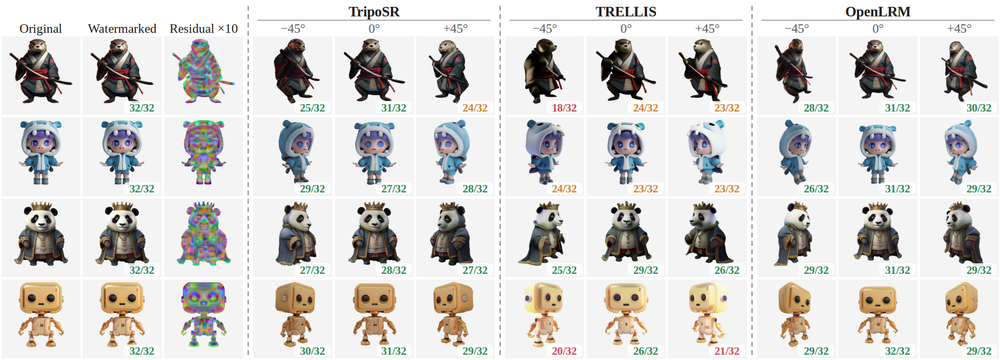

# WIS3R: Watermarking Images with Zero-Shot Survival across 3D Reconstructors

**Akis Iochanas**1, **Nikitas Chatzis**1, **Marios Loizou**1,2, **Evangelos Kalogerakis**1

1Technical University of Crete 2CYENS Centre of Excellence

**Paper:** (coming soon) | **Code:** (coming soon)

WIS3R embeds a hidden 32-bit key in the object image. Each image-to-3D model reconstructs a 3D asset from the published image, and the key is read back blind from one render of that asset. Under each render is the number of its 32 bits matching the key. WIS3R was trained on TripoSR alone, the rest of the models are never seen in training (zero-shot).

## Abstract 

Image-to-3D reconstruction can disrupt image watermarks by regenerating object appearance and rendering it from new viewpoints. We present WIS3R, an image watermarking framework for blind recovery across viewpoint changes and unseen 3D reconstructors. WIS3R embeds a 32-bit message using content-attached RGB carriers computed from frozen DINO and VGG features by a lightweight network shared between its encoder and decoder. A matched decoder re-estimates the carriers from a single render, requiring no source image, 3D asset, camera pose, or reconstructor identity. The encoder and decoder are trained jointly, while embedding is feed-forward and requires no per-image optimization or reconstruction model at deployment. At 35dB foreground PSNR on held-out objects, training with 2D augmentations alone achieves 77.7% mean bit accuracy across eight unseen reconstructors. Training through one frozen reconstructor, TripoSR, yields 86.2% on TripoSR and 83.7% mean bit accuracy across seven unseen models spanning NERFs, textured meshes, and GSplats, outperforming SOTA image-watermarking baselines, which remain near chance.

## Code 

The code will be released in this repository soon.

## Acknowledgements

This project has received funding from the European Research Council (ERC) under the Horizon Research and Innovation Programme (Grant agreement No. 101124742).